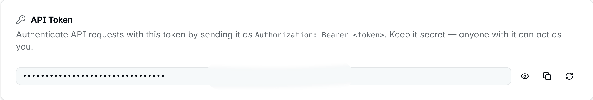

# Dreamteam CRM API (v4.1.1)

The Dreamteam CRM API lets you programmatically access and manage your CRM data — contacts, companies, deals, users, and pipelines. All endpoints follow REST conventions and return JSON.

What's in this doc:

- **Introduction** — authentication, the API token, request/response patterns (pagination, sorting, errors)
- **Schema** — describe an object type and list its association types
- **Records** — create, read, and update records for any object type
- **Find Records** — filter records by criteria, and batch-fetch records by a list of IDs
- **Users** — lookup users in your organization (for owner IDs, activity attribution, permission checks)
- **Pipelines** — lookup deal pipelines and their stages

## Concepts

The vocabulary the rest of this doc uses:

| Term | Meaning |
|---|---|
| **Record** | One row in Dreamteam — a contact, company, deal, note, meeting, or task. Each has a stable numeric `id`. |
| **Object type** | The kind of record. One of `contact`, `company`, `deal`, `note`, `meeting`, `task`. |
| **Property** | A field on a record — like `first_name` on a contact, `amount` on a deal. Full list per object type via **Describe Object**. |
| **Association** | A link between two records — e.g. a contact belongs to a company. Full list via **Association Definitions**. |
| **Pipeline** | The stages a deal moves through, from open to closed won/lost. Read via **Pipelines**. |

## Authentication

```javascript
Base URL: https://api.dreamteamcrm.ai/api/v1
```

The base URL is the same for all customers. Your Bearer token identifies your organization.

| Header | Value | Required |
|---|---|---|
| `Authorization` | `Bearer <YOUR_TOKEN>` | Always |
| `Content-Type` | `application/json` | POST requests |
| `Content-Type` | `application/merge-patch+json` | PATCH requests |

> Your API token does not expire automatically. It remains valid until you regenerate it from your profile page. If you suspect a security breach, regenerate the token immediately — the previous token will stop working.

## How to Get Your API Token

1. Click your **profile avatar** (bottom-left corner)
2. Click **View Profile**
3. Scroll to the **API Token** section at the bottom
4. Use the icons next to the masked token:
   - **Reveal** — show the token in plaintext
   - **Copy** — copy the token to your clipboard
   - **Reset** — rotate the token; the previous one is invalidated immediately



## Try your first call

Once you have a token, list some records to confirm it works:

```bash
curl 'https://api.dreamteamcrm.ai/api/v1/objects/contact/records' \
  --header 'Authorization: Bearer <YOUR_TOKEN>'
```

You should get a JSON response with a `results` array. If you get a `401`, double-check that the token was pasted whole and that the header value starts with `Bearer ` (with a trailing space).

## Pagination

All list endpoints use offset-based pagination. Page numbers start at **1**. Default `page_size` is **20**. Max is **100** — if you pass a higher value, it caps at 100 (no error).

**GET endpoints** — query parameters:

```
?page=1&page_size=20
```

**POST filter endpoints** — request body:

```json
"pagination": { "page": 1, "page_size": 25 }
```

## Sorting

**GET endpoints** pass sort as a query parameter:

```
?sort=created_at,desc
```

**POST filter endpoints** include sort in the request body:

```json
"sort": { "field": "created_at", "direction": "DESC" }
```

Valid directions: `ASC` (ascending) and `DESC` (descending).

## Errors

| Status | Meaning |
|---|---|
| `2xx` | Success |
| `400` | Bad request — the request failed validation (a missing required field, an invalid or duplicate value, or a malformed body) |
| `401` | Unauthorized — invalid or missing Bearer token |
| `403` | Forbidden — you don't have access to this record (for example a task that belongs to someone else) |
| `404` | Not found — no record with that id, or an unknown object type in the URL |
| `409` | Conflict — the request clashes with the resource's current state (for example deleting a company that still has deals attached) |
| `415` | Unsupported media type — the request's `Content-Type` isn't accepted (for example a `PATCH` sent without `application/merge-patch+json`) |
| `500` | Server error |

If you see a `401`, first double-check the token — a typo or the wrong environment's token is the most common cause. Generate a new token from your profile page only if you suspect the token has been leaked or you need to rotate it as part of a security review.

### 401 response body

```json
{
  "message": "Unauthorized access",
  "path": "/api/v1/objects/contact/records",
  "timestamp": "2026-07-02T08:26:39.437256781"
}
```

### Error response shape

Most errors return a JSON body of the shape `{ code, message, errors[], path, timestamp }`. The `code` at the top tells you what kind of error it is: `VALIDATION_FAILED` on a `400`, `NOT_FOUND` on a `404`, `CONFLICT` on a `409`. The `errors` list names the individual fields that were wrong, which the next section covers. It is always there, but it is empty when the problem is not about particular fields. Sign-in and access errors are shorter and carry **no `code`**: a `401` says `"message": "Unauthorized access"` and a `403` says `"message": "Access denied"`, each with just `path` and `timestamp`.

### Validation errors (400)

A `400` comes in two kinds. The common one is a problem with a field you sent: the `code` is `VALIDATION_FAILED`, and each entry in the `errors` list carries its own code saying what went wrong.

| Sub-code | Meaning |
|---|---|
| `REQUIRED_FIELD_MISSING` | A required field was not included. e.g. "Field 'email' is required." |
| `DUPLICATE_VALUE` | A unique field already has this value on another record. e.g. "Field 'email' must be unique. Value 'ada@example.com' already exists (conflicting record ID: 1012888)." |
| `INVALID_FIELD` | A field was given a value it doesn't accept. e.g. "Field 'stage_id' is invalid." |
| `UNKNOWN_FIELD` | The payload named a field that isn't on the object's schema. |
| `MAX_LENGTH_EXCEEDED` | A value is longer than the maximum configured for that field. |
| `INVALID_SORT_FIELD` | The `sort` parameter named a field that can't be sorted on (list and find). |

The other kind is a request Dreamteam could not read at all: a body that is not valid JSON, a query parameter of the wrong type, or a required parameter you left off. These also return `400`, but the `code` is `COMMON-1000`, the `message` is a short note about what could not be read, and there is no `errors` list.

Use the **Describe Object** endpoint to check which fields are required, unique, or length-limited before writing.

### 404 causes

A `NOT_FOUND` means either the record `id` doesn't exist for that object type, or the object type in the URL is invalid — e.g. `contacts` (plural) instead of `contact`. Double-check that object types are singular and that the id exists.

---

## Schema

Discover the field schema and available association types for any object. Call these before creating, updating, or filtering records — they tell you the valid field names, types, and constraints, and which association kinds an object supports.

### List Object Types

`GET /api/v1/objects`

Returns the short name, or **slug**, of every object in your workspace. That covers the standard CRM objects and every custom object you have set up. Use it to find the slug that goes in the `{object}` part of every other URL.

**To see only your custom objects**, call Describe Object on each slug and keep the ones where `object_kind` is `CUSTOM`. Standard objects report `STANDARD`.

```bash
curl --location 'https://api.dreamteamcrm.ai/api/v1/objects' \
  --header 'Authorization: Bearer <YOUR_TOKEN>'
```

**Response `200 OK`** (an array of object type slugs; `subscription` and `project` here are example custom objects)

```json
[
  "company",
  "contact",
  "deal",
  "note",
  "meeting",
  "task",
  "recording",
  "subscription",
  "project"
]
```

### Describe Object

`GET /api/v1/objects/{object}`

Returns the full field schema for an object type. **Always call this first** before creating, updating, or filtering records — it tells you the valid field names, types, and constraints (required, unique, read-only) for each object.

`{object}` is the object type — `contact`, `company`, `deal`, `note`, `meeting`, `task`.

**Path parameters**

| Name | Type | Description |
|---|---|---|
| `object` | string | Object type — one of `contact`, `company`, `deal`, `note`, `meeting`, `task`. |

**Request**

```bash
curl --location 'https://api.dreamteamcrm.ai/api/v1/objects/contact' \
  --request GET \
  --header 'Authorization: Bearer <YOUR_TOKEN>'
```

**Response `200 OK`**

```json
{
  "name": "contact",
  "label": "Contact",
  "plural_label": "Contacts",
  "object_kind": "STANDARD",
  "version": 62,
  "fields": [
    {
      "name": "first_name",
      "type": "TEXT",
      "label": "First Name",
      "filterable": true,
      "read_only": false,
      "unique": false,
      "required": true
    },
    {
      "name": "email",
      "type": "EMAIL",
      "label": "Email",
      "filterable": true,
      "read_only": false,
      "unique": true,
      "required": true
    },
    {
      "name": "created_at",
      "type": "TIMESTAMP",
      "label": "Created At",
      "filterable": true,
      "read_only": true,
      "unique": false,
      "required": false
    }
  ]
}
```

### Association Definitions

`GET /api/v1/objects/{object}/associations`

Returns the association definitions a type can participate in. Use the optional `target_type` query parameter to filter to definitions linking to a specific target. Reads through to the association catalog — useful for discovering valid `association_name` before reading links.

The association types available depend on the object. For example, `contact` supports `company`, `deal`, `note`, `meeting`, `task`. Other objects will have their own set — always call this endpoint to discover the valid types for the object you're working with.

**Path parameters**

| Name | Type | Description |
|---|---|---|
| `object` | string | Object type — one of `contact`, `company`, `deal`, `note`, `meeting`, `task`. |

**Query parameters**

| Name | Type | Required | Description |
|---|---|---|---|
| `target_type` | string | no | Optional — restrict to definitions linking to this target object type. |

**Request**

```bash
curl --location 'https://api.dreamteamcrm.ai/api/v1/objects/contact/associations?target_type=company' \
  --request GET \
  --header 'Authorization: Bearer <YOUR_TOKEN>'
```

**Response `200 OK`**

```json
[
  {
    "association_name": "company_contact_assoc",
    "label": "Company",
    "source_object": "contact",
    "target_object": "company",
    "cardinality": "MANY_TO_MANY",
    "is_default": false,
    "is_lookup": true,
    "is_active": true
  }
]
```

---

## Records

Create, get, and update records. `contact`, `company`, `deal`, `note`, and `task` records are createable through this API, as are records of any **custom object type**. Some system-managed types are read-only, for instance `recording` records are ingested by call and meeting integrations and reject direct creation, though they still appear in reads and associations.

**The record model.** Every record has a stable numeric `id`, a `type` (its object type), and a `properties` object whose shape depends on the type. Reads can also embed an `associations` block (linked records grouped by type), and every record carries `created_at`, `updated_at`, and `created_by`.

**AI-generated fields live inside `properties`**, next to the schema fields. Text-heavy ones are prefixed `ai_` (e.g. `ai_about`, `ai_exec_summary`) and come back as a **JSON string** encoding a *card* — `{ "title", "icon_category", "content": [...], "metadata" }` — which some fields return as an array; scalar signals like `engagement`, `confidence`, `risk`, and `icp` are plain values. All are **read-only** and populated **asynchronously**, so a freshly-created record returns them empty or absent. A full record therefore looks like:

```json
{
  "id": 1015634,
  "type": "contact",
  "properties": {
    "first_name": "Ada",
    "last_name": "Chen",
    "email": "ada@example.com",
    "owner_id": 1000052,
    "engagement": "Medium",
    "ai_exec_summary": "[{\"title\":\"Executive Summary\",\"icon_category\":\"executive_summary\",\"content\":[{\"icon_category\":\"briefcase\",\"value\":\"Contact at Analytical Engines Ltd; captured from an inbound email.\"}]}]",
    "ai_about": "{\"title\":\"About Ada Chen\",\"icon_category\":\"contact_overview\",\"content\":[{\"icon_category\":\"briefcase\",\"value\":\"Contact at Analytical Engines Ltd, reachable at ada@example.com.\"}],\"metadata\":{\"tags\":[{\"icon_category\":\"map_pin\",\"value\":\"Cambridge, UK\"}],\"links\":[]}}"
  },
  "created_at": "2026-06-29T10:23:27.444871Z",
  "updated_at": "2026-06-29T10:23:35.757096Z",
  "created_by": 1000052
}
```

### Create a Record

`POST /api/v1/objects/{object}/records`

Creates one record. Fields go inside `properties`. To link related records at creation time, set the object's lookup fields inside `properties` (named `<object>_ids`, e.g. `company_ids`, `contact_ids`) — there is no separate `associations` array. Use the Schema endpoint under **Schema** to see valid fields, including lookup fields, for each object type.

**Naming — lookup field vs `association_name`.** The lookup field you write and the identifier you read back refer to the same underlying link, but are named differently:

| Where | Field name | Value example |
|---|---|---|
| Request (when creating a record) | `<object>_ids` lookup field | `"company_ids": [1011597]` |
| Response (when reading a record with `?associations=`) | `association_name` | `"company_deal_assoc"` (full identifier) |

**Path parameters**

| Name | Type | Description |
|---|---|---|
| `object` | string | Object type slug |

**Example — Contact**

```bash
curl --location 'https://api.dreamteamcrm.ai/api/v1/objects/contact/records' \
  --request POST \
  --header 'Authorization: Bearer <YOUR_TOKEN>' \
  --header 'Content-Type: application/json' \
  --data '{
  "properties": {
    "first_name": "Ada",
    "last_name": "Chen",
    "email": "ada@example.com"
  }
}'
```

**Response `201 OK`**

```json
{
  "id": 1015634,
  "type": "contact",
  "properties": {
    "first_name": "Ada",
    "last_name": "Chen",
    "email": "ada@example.com",
    "owner_id": 1000052,
    "contact_activity_status": "New"
  },
  "created_at": "2026-06-30T10:58:41.740762Z",
  "updated_at": "2026-06-30T10:58:41.740762Z",
  "created_by": 1000052
}
```

**Example — Note.** A note is created through the same endpoint with `note` in the path. `content` is optional, and a note needs no linked record; attach it to one with the usual `<object>_ids` lookup fields. A note has no unique or required field, so a well-formed note create does not hit the `400` cases the typed objects return.

```bash
curl --location 'https://api.dreamteamcrm.ai/api/v1/objects/note/records' \
  --request POST \
  --header 'Authorization: Bearer <YOUR_TOKEN>' \
  --header 'Content-Type: application/json' \
  --data '{
  "properties": {
    "content": "Met Ada at the Cambridge conference; wants a follow-up demo.",
    "contact_ids": [1015634]
  }
}'
```

**Createable object types.** The endpoint creates the standard CRM record types `contact`, `company`, `deal`, `note`, and `task`, plus records of any **custom object type**. A custom object's type and fields are defined in the CRM, not through this API; once it exists, its records are created, read, updated, and deleted through these same generic routes. A `note` is created from its `content` (which is optional) and can be saved with or without a linked record; link notes, like any type, through the `<object>_ids` lookup fields (for example `contact_ids`). Some types are read-only through this API: `recording` records are ingested by call/meeting integrations and reject direct creation (`403`).

### List Records

`GET /api/v1/objects/{object}/records`

Returns the records you have access to, a page at a time.

By default the sample request includes `?associations=company&associations=note`, and each contact in the response embeds those linked records under an `associations` block. **To skip embedded associations**, drop the `?associations=` query parameter(s) — the response will contain only each record's own `properties`.

**Path parameters**

| Name | Type | Description |
|---|---|---|
| `object` | string | Object type slug |

**Query parameters**

| Name | Type | Required | Description |
|---|---|---|---|
| `page` | integer | no | Page number, starts at `1` |
| `page_size` | integer | no | Page size. Default 20. Max 100 — higher values are silently capped at 100 (no error). |
| `sort` | string | no | Sort spec, e.g. `created_at,desc` |
| `associations` | array | no | Object types to embed (repeatable, capped at 100 per type). Omit to skip embedding. |

**Request**

```bash
curl --location 'https://api.dreamteamcrm.ai/api/v1/objects/contact/records?sort=created_at,desc&associations=company&associations=note' \
  --request GET \
  --header 'Authorization: Bearer <YOUR_TOKEN>'
```

**Response `200 OK`**

```json
{
  "results": [
    {
      "id": 1015634,
      "type": "contact",
      "properties": {
        "first_name": "Ada",
        "last_name": "Chen",
        "email": "ada@example.com",
        "source": "Email",
        "owner_id": 1000052,
        "contact_activity_status": "New"
      },
      "associations": {
        "company": {
          "records": [
            {
              "id": 1011597,
              "association_name": "company_contact_assoc"
            }
          ],
          "metadata": {
            "total": 1,
            "has_more": false
          }
        },
        "note": {
          "records": [
            {
              "id": 1005567,
              "association_name": "contact_notes_assoc"
            },
            {
              "id": 1005568,
              "association_name": "contact_notes_assoc"
            }
          ],
          "metadata": {
            "total": 2,
            "has_more": false
          }
        }
      },
      "created_at": "2026-06-29T10:23:27.444871Z",
      "updated_at": "2026-06-29T10:23:35.757096Z",
      "created_by": 1000052
    }
  ],
  "metadata": {
    "page": 1,
    "page_size": 20,
    "total_elements": 1,
    "total_pages": 1,
    "has_next": false,
    "has_previous": false
  }
}
```

### Get a Record by ID

`GET /api/v1/objects/{object}/records/{id}`

Fetch one record. By default the sample request includes `?associations=company&associations=contact` and the response embeds those linked records under an `associations` block grouped by type. Each entry has a `records` array of `{id, association_name}` pairs and a `metadata` object with `total` count and `has_more` flag.

**To skip embedded associations**, drop the `?associations=` query parameter(s) from the request — the response will contain only the record's own `properties`.

Use the **Association Definitions** endpoint under **Schema** to discover which association types are available for each object. Embedded associations are capped at **100 per type** in this response. If a type has more than 100 (`has_more` is `true`), paginate the rest with the dedicated endpoint:

```
GET /api/v1/objects/{object}/records/{id}/associations/{target_type}?page=1&page_size=50
```

To fetch a note's content, call this same endpoint with `object=note` and the note's id. A note is a record like any other.

**Path parameters**

| Name | Type | Description |
|---|---|---|
| `object` | string | Object type — one of `contact`, `company`, `deal`, `note`, `meeting`, `task`. |
| `id` | integer | Record ID |

**Query parameters**

| Name | Type | Required | Description |
|---|---|---|---|
| `associations` | array | no | Object types to embed (repeatable, capped at 100 per type). Remove to skip embedding. |

**Request**

```bash
curl --location 'https://api.dreamteamcrm.ai/api/v1/objects/deal/records/123?associations=company&associations=contact' \
  --request GET \
  --header 'Authorization: Bearer <YOUR_TOKEN>'
```

**Response `200 OK`**

```json
{
  "id": 1011624,
  "type": "deal",
  "properties": {
    "name": "Analytical Engines - Q3",
    "amount": 100000.0,
    "expected_close_date": "2026-07-18T18:30:00Z",
    "stage_id": 1000003,
    "owner_id": 1000052,
    "pipeline_id": 1000000,
    "confidence": "Medium",
    "forecast_category": "Pipeline",
    "risk": "Medium",
    "status": "Red Flag",
    "last_activity_date": "2026-06-08T16:45:52Z"
  },
  "associations": {
    "company": {
      "records": [
        {
          "id": 1011597,
          "association_name": "company_deal_assoc"
        }
      ],
      "metadata": {
        "total": 1,
        "has_more": false
      }
    },
    "contact": {
      "records": [
        {
          "id": 1015634,
          "association_name": "contact_deal_assoc"
        },
        {
          "id": 1015635,
          "association_name": "contact_deal_assoc"
        }
      ],
      "metadata": {
        "total": 2,
        "has_more": false
      }
    }
  },
  "created_at": "2026-05-20T13:00:55.857056Z",
  "updated_at": "2026-06-12T08:13:25.348504Z",
  "created_by": 1000052
}
```

### Update a Record — Patch (Merge)

`PATCH /api/v1/objects/{object}/records/{id}`

Merges the provided fields into the existing record. Omitted fields are left unchanged. Set a field to `null` to explicitly clear it. Content-Type must be `application/merge-patch+json`.

**Path parameters**

| Name | Type | Description |
|---|---|---|
| `object` | string | Object type slug |
| `id` | integer | Record ID |

**Request**

```bash
curl --location 'https://api.dreamteamcrm.ai/api/v1/objects/contact/records/123' \
  --request PATCH \
  --header 'Authorization: Bearer <YOUR_TOKEN>' \
  --header 'Content-Type: application/merge-patch+json' \
  --data '{
  "properties": {
    "state": null,
    "linkedin": "www.linkedin.com/in/adachen"
  }
}'
```

**Response `200 OK`**

```json
{
  "id": 1015634,
  "type": "contact",
  "properties": {
    "first_name": "Ada",
    "last_name": "Chen",
    "email": "ada@example.com",
    "owner_id": null,
    "contact_activity_status": "New",
    "criticality": "Yes",
    "state": null,
    "linkedin": "www.linkedin.com/in/adachen"
  },
  "created_at": "2026-06-30T11:46:12.210656Z",
  "updated_at": "2026-07-01T09:25:31.825186Z",
  "created_by": 1000052
}
```

---

### Delete a Record

`DELETE /api/v1/objects/{object}/records/{id}`

Permanently deletes a record by id. On success the endpoint returns `204 No Content` with an empty body — and it returns the same `204` even when no record with that id exists, so a delete is safe to repeat. There is no JSON to parse, so check the status code. Deleting is permanent: there is no recycle bin and no restore endpoint. Records that exist only inside the one you delete, such as its notes, are removed with it.

Deleting a `company` that still has one or more deals attached returns `409 Conflict` — delete or move those deals first, then delete the company. Deleting a `contact` or a `deal` is never blocked this way.

**Path parameters**

| Name | Type | Description |
|---|---|---|
| `object` | string | Object type slug, e.g. `contact`, `company`, `deal`, `note`, `task`, or a custom object |
| `id` | integer | Record ID to delete |

**Request**

```bash
curl --location --request DELETE 'https://api.dreamteamcrm.ai/api/v1/objects/contact/records/1015634' \
  --header 'Authorization: Bearer <YOUR_TOKEN>'
```

**Response `204 No Content`** — success (also returned when no record with that id exists)

The response body is empty. Deleting a `contact` or a `deal` always returns `204`.

**Response `409 Conflict`** — a `company` that still has deals attached (contacts and deals are never blocked)

```json
{
  "code": "CONFLICT",
  "message": "Cannot delete company: one or more deals still reference this company. Delete or move the deals first.",
  "errors": [],
  "path": "/api/v1/objects/company/records/1011597",
  "timestamp": "2026-09-24T09:09:12.212132149"
}
```

---

## Find Records

Query records by criteria without pulling every record and filtering client-side. Use **Filter** for any combination of conditions on one or more fields. Use **Batch Fetch by IDs** when you already have a set of IDs (e.g. from a search response or an embedded association list) and need the full records — one call instead of N.

## Filter Syntax

```json
{
  "filter_groups": [
    {
      "logical_operator": "AND",
      "filters": [
        {
          "field_path": "<field_name>",
          "operator": "<OPERATOR>",
          "value": "<value>"
        }
      ]
    }
  ],
  "pagination": { "page": 1, "page_size": 25 },
  "sort": { "field": "created_at", "direction": "DESC" }
}
```

Filters within a group are combined using the group's `logical_operator` (`AND` or `OR`). Multiple `filter_groups` are combined with **OR**.

> **Body keys accept either case.** `filter_groups`/`field_path` (snake_case) and `filterGroups`/`fieldPath` (camelCase) both work. The value in `field_path` (and `sort.field`) must be the actual snake_case field name.

Defaults if omitted: `logical_operator` is `AND`; pagination is `page` 1, `page_size` 20 (max 100); `sort.direction` is `ASC` or `DESC`.

## Operators

| Operator | Value field | Description |
|---|---|---|
| `EQUALS` | `value` | Exact match (=). Works with all field types |
| `NOT_EQUALS` | `value` | Does not equal (≠) |
| `GREATER_THAN` | `value` | Greater than. Works with numbers and ISO 8601 dates |
| `LESS_THAN` | `value` | Less than. Works with numbers and ISO 8601 dates |
| `GREATER_THAN_OR_EQUAL_TO` | `value` | Greater than or equal to (≥) |
| `LESS_THAN_OR_EQUAL_TO` | `value` | Less than or equal to (≤) |
| `BETWEEN` | `values` (array of 2) | Inclusive range match. e.g. `"values": [10, 10000]` |
| `IN` | `values` (array) | Matches any value in the array |
| `NOT_IN` | `values` (array) | Excludes records matching any value in the array |
| `IS_NULL` | none | Field is empty (omit `value`) |
| `IS_NOT_NULL` | none | Field is not empty (omit `value`) |
| `CONTAINS` | `value` | Substring match (text fields) |
| `STARTS_WITH` | `value` | Prefix match (text fields) |
| `ENDS_WITH` | `value` | Suffix match (text fields) |

> Not all operators work with all field types. Comparison operators work with numbers and dates. Text operators work with text fields. `EQUALS`, `IN`, `IS_NULL`, `IS_NOT_NULL` work everywhere.

### Filter

`POST /api/v1/objects/{object}/records/filter`

Compound filter over any object type. `filter_groups` are combined with **OR**; the `filters` within one group are combined by the group's `logical_operator` (`AND` / `OR`). Two examples are shown below — a single-field filter (contacts in one city) and a multi-field filter (contacts by owner + city + recent activity).

**Path parameters**

| Name | Type | Description |
|---|---|---|
| `object` | string | Object type — one of `contact`, `company`, `deal`, `note`, `meeting`, `task`. |

**Example — Single filter — contacts in one city**

```bash
curl --location 'https://api.dreamteamcrm.ai/api/v1/objects/contact/records/filter' \
  --request POST \
  --header 'Authorization: Bearer <YOUR_TOKEN>' \
  --header 'Content-Type: application/json' \
  --data '{
  "filter_groups": [
    {
      "filters": [
        {
          "field_path": "city",
          "operator": "EQUALS",
          "value": "San Francisco"
        }
      ]
    }
  ],
  "pagination": {
    "page": 1,
    "page_size": 25
  }
}'
```

**Example — Multi-field filter — contacts by owner + city + recent activity**

```bash
curl --location 'https://api.dreamteamcrm.ai/api/v1/objects/contact/records/filter' \
  --request POST \
  --header 'Authorization: Bearer <YOUR_TOKEN>' \
  --header 'Content-Type: application/json' \
  --data '{
  "filter_groups": [
    {
      "logical_operator": "AND",
      "filters": [
        {
          "field_path": "owner_id",
          "operator": "EQUALS",
          "value": 1000052
        },
        {
          "field_path": "city",
          "operator": "EQUALS",
          "value": "San Francisco"
        },
        {
          "field_path": "last_activity_date",
          "operator": "GREATER_THAN",
          "value": "2026-04-01T00:00:00Z"
        }
      ]
    }
  ],
  "pagination": {
    "page": 1,
    "page_size": 25
  },
  "sort": {
    "field": "last_activity_date",
    "direction": "DESC"
  }
}'
```

**Response `200 OK`**

```json
{
  "results": [
    {
      "id": 1015634,
      "properties": {
        "first_name": "Ada",
        "last_name": "Chen",
        "email": "ada@example.com",
        "owner_id": 1000052,
        "city": "San Francisco",
        "last_activity_date": "2026-06-14T09:22:11.104Z"
      }
    }
  ],
  "metadata": {
    "page": 1,
    "page_size": 25,
    "total_elements": 1,
    "total_pages": 1,
    "has_next": false,
    "has_previous": false
  }
}
```

### Batch Fetch by IDs

When you already have a list of record IDs, hit the same **Filter** endpoint (`POST /api/v1/objects/{object}/records/filter`) with an `IN` filter on `id` to get them all in a single call. This isn't a separate endpoint — it's the filter pattern you'll reach for most often.

**When to use it**

- Hydrating associated records — a `Get Record` response embeds associations as `{id, association_name}` pairs. One call replaces N individual `Get Record` calls.
- Any time you have a set of IDs on hand (from a search, a webhook, a spreadsheet import) and need the underlying records.

> Under the hood this is the `/records/filter` endpoint with an `IN` filter on `id`. It's documented as its own operation for clarity.

**Request**

```bash
curl --location 'https://api.dreamteamcrm.ai/api/v1/objects/company/records/filter' \
  --header 'Content-Type: application/json' \
  --header 'Authorization: Bearer <YOUR_TOKEN>' \
  --data '{
    "filterGroups": [
      { "filters": [ { "fieldPath": "id", "operator": "IN", "values": [1011597, 1011598] } ] }
    ]
  }'
```

**Response `200 OK`**

```json
{
  "results": [
    {
      "id": 1011597,
      "properties": {
        "name": "Analytical Engines Ltd",
        "domain": "analytical-engines.com",
        "industry": "Hardware",
        "company_size": 240
      }
    },
    {
      "id": 1011598,
      "properties": {
        "name": "Babbage Systems",
        "domain": "babbagesystems.com",
        "industry": "Technology",
        "company_size": 780
      }
    }
  ],
  "metadata": {
    "page": 1,
    "page_size": 20,
    "total_elements": 2,
    "total_pages": 1,
    "has_next": false,
    "has_previous": false
  }
}
```

---

## Tasks

A task is a to-do or action item attached to your CRM records. A task is a record, so you create, read, update, delete, and list tasks through the same `/api/v1/objects/task/records` routes as any other object - see the **Records** section for the full request and response shapes. This section covers what is specific to tasks: the fields, the link rules, completing a task, and the one task-only endpoint, reassignment.

**Fields you can set:** `title` (required), `description`, `status` (`Open` default, `Pending`, `Done`, `Recommended`), `priority` (`High` default, `Medium`, `Low`), `due_at` / `reminder_at` / `completed_at` (ISO 8601 datetimes), `owner_id` (the "Assign To" user; omit to assign to yourself), `contact_ids` / `company_ids` / `deal_ids` (the records the task is about), and `meeting_id`. Other fields (`task_source`, `task_type`, ranking fields) are system-managed; an API-created task is stamped `task_source: "USER"`, `task_type: "USER_TASK"`.

**Two rules specific to tasks:**
- **At least one linked record.** Every task names at least one `contact`, `company`, or `deal` in `properties`. A title-only task is rejected: `"A task needs at least one contact, company or deal."`
- **Linked records share one company.** Everything a task links to must roll up to the same company, or it is refused: `"The records on a task must share one company: ..."`.

**Standard record operations.** A task is a record, so create, retrieve, update, delete, and list use the generic object routes documented under **Records** - only the object type in the path changes to `task`:

- **Create** - `POST /api/v1/objects/task/records` (worked below, because of the link rules)
- **Retrieve** - `GET /api/v1/objects/task/records/{id}`
- **Update** - `PATCH /api/v1/objects/task/records/{id}` - a plain edit; it cannot change the owner (that is a reassignment) or remove the task's last linked record
- **Delete** - `DELETE /api/v1/objects/task/records/{id}` - returns `204 No Content`, and the same `204` even if no task with that id exists; deleting someone else's task returns `403`
- **List** - `GET /api/v1/objects/task/records`

**You can only act on a task you have access to.** To edit, complete or delete a task, you need access to it, which normally means you own it. Dreamteam checks this the same way it checks any other record. It makes no difference who created the task: one Sally made is not protected any differently, and it gives you no rights over a task that belongs to someone else. Try to edit, complete or delete another person's task and you get `403` with the body `{"message": "Access denied"}`. It is the same rule you see in the app, where *Mark as done*, dismiss and delete simply do not appear on a task that is not yours. Workspace admins can act on any task.

The sections below cover what is task-specific: creating a task (the link rules bite here), editing one, completing one, deleting one, and reassignment.

### Create a Task

`POST /api/v1/objects/task/records`

Pass `title` plus at least one linked record. Omit `owner_id` to assign the task to yourself. The records you link appear under the task's `associations` (retrieve with `?associations=contact`), not in `properties`.

**Request**

```bash
curl --location 'https://api.dreamteamcrm.ai/api/v1/objects/task/records' \
  --request POST \
  --header 'Authorization: Bearer <YOUR_TOKEN>' \
  --header 'Content-Type: application/json' \
  --data '{
  "properties": {
    "title": "Follow up with Ada about the renewal",
    "description": "Send the updated quote and confirm the renewal date.",
    "priority": "High",
    "due_at": "2026-10-20T17:00:00Z",
    "contact_ids": [1015634]
  }
}'
```

**Response `201 Created`**

```json
{
  "id": 1044516,
  "type": "task",
  "properties": {
    "task_source": "USER",
    "owner_id": 1000052,
    "description": "Send the updated quote and confirm the renewal date.",
    "due_at": "2026-10-20T17:00:00Z",
    "title": "Follow up with Ada about the renewal",
    "priority": "High",
    "task_type": "USER_TASK",
    "status": "Open"
  },
  "created_at": "2026-10-15T09:58:49.930855783Z",
  "updated_at": "2026-10-15T09:58:49.930855783Z",
  "created_by": 1000052
}
```

**Response `400` (linked records on different companies)**

```json
{
  "code": "VALIDATION_FAILED",
  "message": "The records on a task must share one company: deal 1032672 belongs to company [1031396] and contact 1026842 belongs to company [1005738]",
  "errors": [],
  "path": "/api/v1/objects/task/records",
  "timestamp": "2026-10-15T10:02:09.236556190"
}
```

### Edit a Task

`PATCH /api/v1/objects/task/records/{id}`

Send only the fields you want to change. Anything you leave out keeps the value it already had, and sending a field as `null` clears it. Set the `Content-Type` header to `application/merge-patch+json`. The fields you can change include `title`, `description`, `priority` (`High`, `Medium`, `Low`), `due_at`, `reminder_at` and `status`. An edit keeps the task linked to at least one record on one company, and it cannot change the owner, which is a reassignment instead.

**Request**

```bash
curl --location 'https://api.dreamteamcrm.ai/api/v1/objects/task/records/1044516' \
  --request PATCH \
  --header 'Authorization: Bearer <YOUR_TOKEN>' \
  --header 'Content-Type: application/merge-patch+json' \
  --data '{
  "properties": {
    "title": "Follow up with Ada about the renewal (revised)",
    "due_at": "2026-10-22T17:00:00Z",
    "priority": "Medium"
  }
}'
```

**Response `200 OK`**

```json
{
  "id": 1044516,
  "type": "task",
  "properties": {
    "task_source": "USER",
    "owner_id": 1000052,
    "description": "Send the updated quote and confirm the renewal date.",
    "due_at": "2026-10-22T17:00:00Z",
    "title": "Follow up with Ada about the renewal (revised)",
    "priority": "Medium",
    "task_type": "USER_TASK",
    "status": "Open"
  },
  "created_at": "2026-10-15T09:58:49.930856Z",
  "updated_at": "2026-10-16T05:20:11.482301746Z",
  "created_by": 1000052
}
```

### Complete a Task

`PATCH /api/v1/objects/task/records/{id}`

Marking a task done is an edit that sets `status` to `Done`. This route does not auto-fill `completed_at` (it comes back absent); set it yourself in the same request if you need that timestamp (now or past).

**Request**

```bash
curl --location 'https://api.dreamteamcrm.ai/api/v1/objects/task/records/1044516' \
  --request PATCH \
  --header 'Authorization: Bearer <YOUR_TOKEN>' \
  --header 'Content-Type: application/merge-patch+json' \
  --data '{
  "properties": {
    "status": "Done"
  }
}'
```

**Response `200 OK`** — the task returns with `"status": "Done"`.

### Delete a Task

`DELETE /api/v1/objects/task/records/{id}`

Deletes a task. This is the standard record delete applied to a task, and it is permanent: there is no undo and no trash. Deleting follows the access rule above. You can delete a task you have access to, and deleting someone else's task returns `403`, no matter who or what created it. Workspace admins can delete any task.

**Request**

```bash
curl --location 'https://api.dreamteamcrm.ai/api/v1/objects/task/records/1044516' \
  --request DELETE \
  --header 'Authorization: Bearer <YOUR_TOKEN>'
```

**Response `204 No Content`** — empty body, so check the status code. The same `204` comes back if no task with that id exists, so a delete you have access to is safe to repeat.

**Response `403` (the task belongs to someone else)**

```json
{
  "message": "Access denied",
  "path": "/api/v1/objects/task/records/1044516",
  "timestamp": "2026-10-16T05:32:10.118904"
}
```

### Find Eligible Assignees

`GET /api/v1/sally/tasks/{id}/reassign-targets`

Returns the colleagues a task can be handed to (activated teammates who can see every record the task is linked to), as a plain array. Use it to pick a valid `newOwnerId`.

**Request**

```bash
curl --location 'https://api.dreamteamcrm.ai/api/v1/sally/tasks/1044516/reassign-targets' \
  --header 'Authorization: Bearer <YOUR_TOKEN>'
```

**Response `200 OK`**

```json
[
  {
    "id": 1000045,
    "first_name": "Sam",
    "last_name": "Okafor",
    "primary_email": "sam.okafor@example.com",
    "username": "sam.okafor@example.com",
    "role": "sales_member",
    "title": "Account Executive",
    "status": "ACTIVATED",
    "sales_user": true,
    "created_at": "2026-05-22T08:38:24.479589Z"
  }
]
```

### Reassign a Task

`PATCH /api/v1/sally/tasks/{id}/reassign`

Hands a task to another rep, the only way to change a task's owner. Note the path: reassignment lives under `/api/v1/sally/tasks/`, not `/api/v1/objects/`. It takes the same Bearer token and works on any task. Only the current owner or a tenant admin can reassign, and only an **open** task can move.

**Request**

```bash
curl --location 'https://api.dreamteamcrm.ai/api/v1/sally/tasks/1044516/reassign' \
  --request PATCH \
  --header 'Authorization: Bearer <YOUR_TOKEN>' \
  --header 'Content-Type: application/json' \
  --data '{
  "newOwnerId": 1000061
}'
```

**Response `200 OK`** — empty body. Common rejections: `400 VALIDATION_FAILED` "This task is no longer open, so it cannot be handed on" or "That person cannot take a task"; `403 FORBIDDEN` when the new owner can't see a linked record or you don't hold the task.

---

## Custom objects

A **custom object** is a kind of record you set up yourself, alongside the ones Dreamteam already gives you like contacts, companies and deals. If you sell subscriptions, track contracts or run projects, each of those can be its own custom object. Its records then behave like any other record: you list, create, edit and delete them through the same URLs, with your object's own short name (its **slug**) in place of `{object}`. The examples below use the slug `subscription`, so swap in one of your own.

- **You build the object in the CRM, not through this API.** This API works with the *records* inside a custom object. It cannot create the object itself, and it cannot add or change its fields. To build one, along with its fields and relationships, see the help-centre guide [Custom objects: building a new kind of record](https://support.dreamteam.ai/articles/4808393548-Custom-objects---building-a-new-kind-of-record). Use **List Object Types** (`GET /api/v1/objects`) to find your slugs, and **Describe Object** to see what fields a slug has, and which ones are required or have to be unique, before you write to it.
- **Required and unique fields are checked.** Leave out a required field and you get `400` with a `REQUIRED_FIELD_MISSING` error. Give a field that has to be unique (usually `name`) a value another record already has, and you get `400` with a `DUPLICATE_VALUE` error naming the record that already holds it. Capital letters are ignored in that check, so *Annual Plan* and *annual plan* count as the same value. These are the same errors any other object returns.
- **Links work the same way as everywhere else.** To attach a record to a contact, company or deal, use the same `<object>_ids` fields inside `properties`, such as `deal_ids`. Call **Association Definitions** for your slug to see what it is allowed to link to.

**Get the list of custom objects.** Call `GET /api/v1/objects` (see **List Object Types** under Schema), then Describe each slug and keep the ones whose `object_kind` is `CUSTOM`.

**List a custom object's records.** `GET /api/v1/objects/{object}/records` returns its records a page at a time: a `results` array holding the records, and a `metadata` block describing the page.

```bash
curl --location 'https://api.dreamteamcrm.ai/api/v1/objects/subscription/records?page=1&page_size=20' \
  --header 'Authorization: Bearer <YOUR_TOKEN>'
```

```json
{
  "results": [
    {
      "id": 1048896,
      "type": "subscription",
      "properties": { "name": "Analytical Engines - Annual Plan", "start_date": "2026-11-01" },
      "created_at": "2026-11-05T10:00:00.000000Z",
      "updated_at": "2026-11-05T10:00:00.000000Z",
      "created_by": 1000052
    }
  ],
  "metadata": { "page": 1, "page_size": 20, "total_elements": 1, "total_pages": 1, "has_next": false, "has_previous": false }
}
```

**Add a record.** `POST /api/v1/objects/{object}/records`. Put the record's fields inside `properties`.

```bash
curl --location 'https://api.dreamteamcrm.ai/api/v1/objects/subscription/records' \
  --request POST \
  --header 'Authorization: Bearer <YOUR_TOKEN>' \
  --header 'Content-Type: application/json' \
  --data '{
  "properties": {
    "name": "Analytical Engines - Annual Plan",
    "start_date": "2026-11-01",
    "deal_ids": [1011624]
  }
}'
```

```json
{
  "id": 1048896,
  "type": "subscription",
  "properties": { "name": "Analytical Engines - Annual Plan", "start_date": "2026-11-01" },
  "created_at": "2026-11-05T10:00:00.000000Z",
  "updated_at": "2026-11-05T10:00:00.000000Z",
  "created_by": 1000052
}
```

**Edit a record.** `PATCH /api/v1/objects/{object}/records/{id}` changes only the fields you send. Anything you leave out keeps the value it already had.

```bash
curl --location 'https://api.dreamteamcrm.ai/api/v1/objects/subscription/records/1048896' \
  --request PATCH \
  --header 'Authorization: Bearer <YOUR_TOKEN>' \
  --header 'Content-Type: application/merge-patch+json' \
  --data '{
  "properties": {
    "start_date": "2026-12-01"
  }
}'
```

**Delete a record.** `DELETE /api/v1/objects/{object}/records/{id}` returns `204 No Content` with an empty body. The delete is permanent, and there is no restore.

```bash
curl --location 'https://api.dreamteamcrm.ai/api/v1/objects/subscription/records/1048896' \
  --request DELETE \
  --header 'Authorization: Bearer <YOUR_TOKEN>'
```

---

## Users

Look up users in your organization. Use these endpoints when you need an owner ID for a record you're creating or updating, when attributing activity to a specific user, or when checking who is on the team.

### List Users

`GET /api/v1/users`

Returns the users in your organization that you have access to. Sensitive fields (passwords, tokens, OTP codes, API keys) are never returned in this response.

**Fields**

| Field | Type | Notes |
|---|---|---|
| `id` | integer | User ID — use as `owner_id` on records. |
| `first_name` / `last_name` | string | |
| `primary_email` / `username` | string | |
| `role` | enum | One of `admin`, `sales_manager`, `sales_member`. |
| `title` | string | Free text; may be empty. |
| `status` | enum | `CREATED` (invited, not yet activated) or `ACTIVATED` (active). |
| `sales_user` | boolean | Whether the user holds a sales seat. |
| `created_at` | string | ISO 8601 timestamp. |

**Query parameters**

| Name | Type | Required | Description |
|---|---|---|---|
| `page` | integer | no | Page number, starts at `1` |
| `page_size` | integer | no | Page size. Default 20. Max 100 — higher values are silently capped at 100 (no error). |
| `sort` | string | no | Sort spec |

**Request**

```bash
curl --location 'https://api.dreamteamcrm.ai/api/v1/users?sort=created_at,desc' \
  --request GET \
  --header 'Authorization: Bearer <YOUR_TOKEN>'
```

**Response `200 OK`**

```json
{
  "results": [
    {
      "id": 1000054,
      "first_name": "Arjun",
      "last_name": "Manager",
      "primary_email": "arjun+mgr@example.com",
      "username": "arjun+mgr@example.com",
      "role": "sales_member",
      "title": "",
      "status": "ACTIVATED",
      "sales_user": false,
      "created_at": "2026-06-12T06:33:35.139985Z"
    },
    {
      "id": 1000051,
      "first_name": "Akarsh",
      "last_name": "",
      "primary_email": "akarsh@example.com",
      "username": "akarsh@example.com",
      "role": "sales_member",
      "title": "GTM - Sales",
      "status": "ACTIVATED",
      "sales_user": false,
      "created_at": "2026-06-08T10:29:13.104277Z"
    }
  ],
  "metadata": {
    "page": 1,
    "page_size": 20,
    "total_elements": 45,
    "total_pages": 3,
    "has_next": true,
    "has_previous": false
  }
}
```

### Get User by ID

`GET /api/v1/users/{id}`

Sensitive fields (passwords, tokens, OTP codes, API keys) are never returned in this response.

**Path parameters**

| Name | Type | Description |
|---|---|---|
| `id` | integer | Numeric identifier of the user. |

**Request**

```bash
curl --location 'https://api.dreamteamcrm.ai/api/v1/users/<id>' \
  --request GET \
  --header 'Authorization: Bearer <YOUR_TOKEN>'
```

**Response `200 OK`**

```json
{
  "associations": null,
  "created_at": "2026-06-12T06:24:58.831219Z",
  "first_name": "Jordan",
  "id": 1000052,
  "last_name": "Rivera",
  "primary_email": "jordan.rivera@example.com",
  "role": "sales_member",
  "sales_user": false,
  "status": "CREATED",
  "title": "",
  "username": "jordan.rivera@example.com"
}
```

---

## Pipelines

Look up deal pipelines and their stages. Use these endpoints when creating deals (you'll need the `pipeline_id` and initial `stage_id`), when displaying pipeline structure in your own UI, or when checking which stages exist and their order.

> **A workspace has exactly one pipeline today.** `List Pipelines` returns a single entry — the endpoint is plural because the resource is, not because a workspace can hold several. Read the `pipeline_id` from it rather than building a pipeline picker.

### List Pipelines

`GET /api/v1/pipelines`

**Query parameters**

| Name | Type | Required | Description |
|---|---|---|---|
| `page` | integer | no | Page number, starts at `1` |
| `page_size` | integer | no | Page size. Default 20. Max 100 — higher values are silently capped at 100 (no error). |
| `sort` | string | no | Sort spec |

**Request**

```bash
curl --location 'https://api.dreamteamcrm.ai/api/v1/pipelines?sort=created_at,desc' \
  --request GET \
  --header 'Authorization: Bearer <YOUR_TOKEN>'
```

**Response `200 OK`**

```json
{
  "results": [
    {
      "created_at": "2026-02-02T12:30:14.308047Z",
      "created_by": 1000000,
      "deleted": false,
      "description": "Standard deal flow pipeline with common stages (e.g., Lead In, Qualified, Proposal, Negotiation, Closed Won/Lost).",
      "external_id": "default_pipeline",
      "id": 1000000,
      "is_default": true,
      "name": "Default Pipeline",
      "updated_at": "2026-05-20T10:06:06.332465Z"
    }
  ],
  "metadata": {
    "page": 1,
    "page_size": 20,
    "total_elements": 1,
    "total_pages": 1,
    "has_next": false,
    "has_previous": false
  }
}
```

### Get Pipeline by ID

`GET /api/v1/pipelines/{id}`

**Path parameters**

| Name | Type | Description |
|---|---|---|
| `id` | integer |  |

**Request**

```bash
curl --location 'https://api.dreamteamcrm.ai/api/v1/pipelines/<id>' \
  --request GET \
  --header 'Authorization: Bearer <YOUR_TOKEN>'
```

**Response `200 OK`**

```json
{
  "created_at": "2026-02-02T12:30:14.308047Z",
  "created_by": 1000000,
  "deleted": false,
  "description": "Standard deal flow pipeline with common stages (e.g., Lead In, Qualified, Proposal, Negotiation, Closed Won/Lost).",
  "external_id": "default_pipeline",
  "id": 1000000,
  "is_default": true,
  "name": "Default Pipeline",
  "updated_at": "2026-05-20T10:06:06.332465Z",
  "stages": [
    {
      "created_at": "2026-02-02T12:30:15.735097Z",
      "created_by": 1000000,
      "deleted": false,
      "description": "",
      "entry_criteria": "Product demo or walkthrough done\nCustomer is actively exploring solutions (not just browsing)\nRequirements documented\nMultiple stakeholders engaged (if applicable)",
      "external_id": "default_stage_default_evaluation",
      "id": 1000002,
      "is_closed": false,
      "name": "Evaluation",
      "pipeline_id": 1000000,
      "stage_category": "Early Stage",
      "stage_order": 1,
      "updated_at": "2026-06-16T08:30:08.840559Z",
      "win_probability": 30
    },
    {
      "created_at": "2026-02-02T12:30:15.005203Z",
      "created_by": 1000000,
      "deleted": false,
      "description": "",
      "entry_criteria": "Customer problem/use case clearly identified\nBasic fit confirmed (industry, size, need)\nKey stakeholder identified\nFirst call completed",
      "external_id": "default_stage_default_requirements_qualified",
      "id": 1000001,
      "is_closed": false,
      "name": "Requirements Qualified",
      "pipeline_id": 1000000,
      "stage_category": "Early Stage",
      "stage_order": 2,
      "updated_at": "2026-06-16T08:30:09.206247Z",
      "win_probability": 10
    },
    {
      "created_at": "2026-02-02T12:30:16.399426Z",
      "created_by": 1000000,
      "deleted": false,
      "description": "",
      "entry_criteria": "Pricing shared with customer\nSolution scope defined\nCustomer confirms interest in moving forward\nDecision process/timeline understood",
      "external_id": "default_stage_default_proposal",
      "id": 1000003,
      "is_closed": false,
      "name": "Proposal Sent",
      "pipeline_id": 1000000,
      "stage_category": "Mid-Level Stage",
      "stage_order": 3,
      "updated_at": "2026-06-17T07:08:26.438759Z",
      "win_probability": 40
    },
    {
      "created_at": "2026-02-02T12:30:17.072626Z",
      "created_by": 1000000,
      "deleted": false,
      "description": "",
      "entry_criteria": "Customer has reviewed proposal\nCommercial terms being discussed (price, discounts, terms)\nDecision-makers actively involved\nClear intent to buy (if terms align)",
      "external_id": "default_stage_default_negotiation",
      "id": 1000004,
      "is_closed": false,
      "name": "Negotiation",
      "pipeline_id": 1000000,
      "stage_category": "Late Stage",
      "stage_order": 4,
      "updated_at": "2026-06-17T07:08:27.167165Z",
      "win_probability": 70
    },
    {
      "created_at": "2026-02-02T12:30:17.717386Z",
      "created_by": 1000000,
      "deleted": false,
      "description": "",
      "entry_criteria": "Final terms agreed verbally or over email\nContract/legal document shared\nProcurement/legal review in progress\nExpected close date confirmed",
      "external_id": "default_stage_default_contract",
      "id": 1000005,
      "is_closed": false,
      "name": "Contract",
      "pipeline_id": 1000000,
      "stage_category": "Late Stage",
      "stage_order": 5,
      "updated_at": "2026-06-17T07:08:27.914900Z",
      "win_probability": 90
    },
    {
      "created_at": "2026-06-12T06:29:14.945165Z",
      "created_by": 1000001,
      "deleted": false,
      "description": "",
      "entry_criteria": "",
      "id": 1013909,
      "is_closed": false,
      "name": "contract done",
      "pipeline_id": 1000000,
      "stage_order": 6,
      "updated_at": "2026-06-17T07:08:28.708357Z",
      "win_probability": 95
    },
    {
      "created_at": "2026-06-16T08:29:17.834415Z",
      "created_by": 1000019,
      "deleted": false,
      "description": "",
      "entry_criteria": "First condition should be met",
      "id": 1014352,
      "is_closed": false,
      "name": "Tst",
      "pipeline_id": 1000000,
      "stage_category": "Early Stage",
      "stage_order": 7,
      "updated_at": "2026-06-17T07:08:29.553321Z",
      "win_probability": 0
    },
    {
      "created_at": "2026-02-02T12:30:18.388575Z",
      "created_by": 1000000,
      "deleted": false,
      "description": "",
      "entry_criteria": "Contract signed\nPayment terms accepted / initial payment triggered\nDeal officially marked won in CRM",
      "external_id": "default_stage_default_closed_won",
      "id": 1000006,
      "is_closed": true,
      "name": "Closed Won",
      "pipeline_id": 1000000,
      "stage_category": "Closed Won",
      "stage_order": 8,
      "updated_at": "2026-06-16T08:30:27.229736Z",
      "win_probability": 100
    },
    {
      "created_at": "2026-02-02T12:30:19.081123Z",
      "created_by": 1000000,
      "deleted": false,
      "description": "",
      "entry_criteria": "Customer explicitly declines OR goes unresponsive after defined follow-ups\nReason for loss captured (price, competitor, no decision, etc.)",
      "external_id": "default_stage_default_closed_lost",
      "id": 1000007,
      "is_closed": true,
      "name": "Closed Lost",
      "pipeline_id": 1000000,
      "stage_category": "Closed Lost",
      "stage_order": 9,
      "updated_at": "2026-06-16T08:30:27.584851Z",
      "win_probability": 0
    }
  ]
}
```

The pipeline is returned with all its stages nested under `stages`. Each stage carries the fields below — use them to decide the "next" stage or to detect a closed deal.

**Stage fields**

| Field | Type | Notes |
|---|---|---|
| `id` | integer | Stage ID — use as `stage_id` when creating or updating a deal. |
| `name` | string | Stage name. |
| `stage_order` | integer | Position in the pipeline (1-based). |
| `stage_category` | string | Grouping, e.g. `Early Stage`, `Mid-Level Stage`, `Late Stage`, `Closed Won`, `Closed Lost`. |
| `win_probability` | integer | 0–100. |
| `is_closed` | boolean | `true` for terminal stages (Closed Won / Closed Lost). |
| `entry_criteria` | string | Newline-separated checklist for entering the stage. |
| `pipeline_id` | integer | The pipeline that owns the stage. |

> **Assigning stages to deals.** Use `stage_id` from this response when creating or updating a deal via the Records endpoints. The deal's `pipeline_id` must match the pipeline that owns the stage.

---

## Recipes

Task-oriented walkthroughs that chain the reference endpoints into an answer. Recipes introduce **no new endpoints** — every call is one of the endpoints documented above, composed into a common workflow.

### Meetings, transcripts & summaries

One recipe answers a whole family of questions — "what meetings has this contact had?", "what was the sentiment?", "where's the summary?", "give me the transcript." They are all reads: start from a contact, follow the association to the meeting, read the meeting's AI summary, highlights and sentiment — then hop one more link to the recording for the transcript itself and the media. The same pattern works from a **company** or **deal** — pass `?associations=meeting` on any of them.

> **Before you start.** Two things carry through every step. These are all **reads** — meetings and recordings are ingested by the call integrations (Recall.ai, Fathom, Clari, and others), so there is no create endpoint, and their AI fields fill in **asynchronously** (wait for the recording's `status_code: "TRANSCRIPT_DONE"`). And like `ai_about`, the AI fields — and the raw `transcript` — come back as **JSON-encoded strings** to parse; `ai_formatted_transcript` is already an object.

#### Step 1 — List the meetings on a contact

Retrieve the contact and embed its meetings with `?associations=meeting`. Embedded associations come back as `{id, association_name}` pairs — ids only. Take the meeting `id` from `associations.meeting.records` into Step 2. Have several? Fetch them all in one call with **Batch Fetch by IDs** (`object=meeting`).

`GET /api/v1/objects/contact/records/{id}`

**Request**

```bash
curl --location 'https://api.dreamteamcrm.ai/api/v1/objects/contact/records/1015634?associations=meeting' \
  --request GET \
  --header 'Authorization: Bearer <YOUR_TOKEN>'
```

**Response `200 OK`**

```json
{
  "id": 1015634,
  "type": "contact",
  "properties": {
    "first_name": "Ada",
    "last_name": "Chen",
    "email": "ada@example.com"
  },
  "associations": {
    "meeting": {
      "records": [
        {
          "id": 1090142,
          "association_name": "contact_meeting_assoc"
        }
      ],
      "metadata": {
        "total": 1,
        "has_more": false
      }
    }
  }
}
```

#### Step 2 — Read the meeting (summary, highlights, sentiment)

Retrieve the meeting by an id from Step 1. It carries the meeting intelligence: `ai_sentiment` (`Good` / `Neutral` / `Bad`) as a plain value, and `ai_meeting_summary`, `ai_meeting_highlights`, `ai_meeting_post_brief` as **JSON-encoded strings** — parse each after reading. `participants` is a comma-separated list of attendee emails. The meeting does **not** hold the transcript — that lives on the recording (Step 3).

`GET /api/v1/objects/meeting/records/{id}`

**Request**

```bash
curl --location 'https://api.dreamteamcrm.ai/api/v1/objects/meeting/records/1090142' \
  --request GET \
  --header 'Authorization: Bearer <YOUR_TOKEN>'
```

**Response `200 OK`**

```json
{
  "id": 1090142,
  "type": "meeting",
  "properties": {
    "title": "Analytical Engines - Q3 renewal call",
    "start_at": "2026-08-14T15:00:00Z",
    "end_at": "2026-08-14T15:30:00Z",
    "external": true,
    "user_id": 1000052,
    "participants": "sam@example.com, ada@example.com",
    "ai_sentiment": "Good",
    "ai_meeting_summary": "{\"meeting_type\":\"Check-in\",\"tags\":[{\"tag_type\":\"topic\",\"value\":\"Renewal\",\"render_type\":\"badge\"}],\"content\":[{\"title\":\"Summary\",\"icon_category\":\"lucide-file-text\",\"value\":\"Ada walked through the Q3 renewal timeline and two open blockers; agreed to follow up on pricing.\"}]}",
    "ai_meeting_highlights": "[{\"heading\":\"Renewal timeline\",\"highlight_callout\":\"Ada confirmed a Q3 renewal target.\",\"highlight_details\":\"...\",\"timestamp\":\"06:14\"}]",
    "ai_meeting_post_brief": "Sam walked Ada through the Q3 renewal plan and agreed to reconnect Monday after sharing pricing."
  },
  "created_at": "2026-08-14T15:31:02.221Z",
  "updated_at": "2026-08-14T15:48:10.984Z",
  "created_by": 1000052
}
```

#### Step 3 — Follow the recording for the transcript

The transcript and media live on the **recording**, one link on from the meeting. It is two calls: first read the meeting's `recording` association to get the recording id, then retrieve the recording. The recording gives you two transcript shapes: `transcript` (the raw provider transcript, a **JSON-encoded string** of `segments`) and `ai_formatted_transcript` (a cleaned **object** of speaker turns with timestamps). `audio_url` and `video_url` are **time-limited signed URLs** — fetch them promptly and don't store the URL itself. Wait for `status_code: "TRANSCRIPT_DONE"` before relying on the transcript fields.

**Call 1 · Get the recording id** (from the meeting)

`GET /api/v1/objects/meeting/records/{id}` (with `?associations=recording`)

**Request**

```bash
curl --location 'https://api.dreamteamcrm.ai/api/v1/objects/meeting/records/1090142?associations=recording' \
  --request GET \
  --header 'Authorization: Bearer <YOUR_TOKEN>'
```

**Response `200 OK`**

```json
{
  "id": 1090142,
  "type": "meeting",
  "associations": {
    "recording": {
      "records": [
        {
          "id": 1090777,
          "association_name": "meeting_recording_assoc"
        }
      ],
      "metadata": {
        "total": 1,
        "has_more": false
      }
    }
  }
}
```

**Call 2 · Read the recording**

`GET /api/v1/objects/recording/records/{id}`

**Request**

```bash
curl --location 'https://api.dreamteamcrm.ai/api/v1/objects/recording/records/1090777' \
  --request GET \
  --header 'Authorization: Bearer <YOUR_TOKEN>'
```

**Response `200 OK`**

```json
{
  "id": 1090777,
  "type": "recording",
  "properties": {
    "provider_name": "recall",
    "status": "completed",
    "status_code": "TRANSCRIPT_DONE",
    "duration_seconds": 1842,
    "recording_started_at": "2026-08-14T15:00:12Z",
    "recording_completed_at": "2026-08-14T15:30:54Z",
    "audio_url": "https://recordings.dreamteamcrm.ai/1090777/audio.mp3?X-Amz-Signature=...",
    "video_url": "https://recordings.dreamteamcrm.ai/1090777/video.mp4?X-Amz-Signature=...",
    "audio_file": 1090780,
    "video_file": 1090781,
    "transcript": "{\"version\":\"1.0\",\"provider\":\"recall\",\"duration_seconds\":1842.0,\"participants\":[{\"id\":\"100\",\"name\":\"Sam\",\"is_host\":true},{\"id\":\"300\",\"name\":\"Ada\",\"is_host\":false}],\"segments\":[{\"speaker_id\":\"100\",\"speaker_name\":\"Sam\",\"start_time\":13.9,\"end_time\":15.3,\"text\":\"Hi Ada, thanks for hopping on.\"}]}",
    "ai_formatted_transcript": {
      "metadata": {
        "hasTimestamps": true,
        "hasSpeakers": true,
        "totalSegments": 315,
        "segmentationType": "speaker_turns",
        "participants": ["Sam", "Ada"]
      },
      "segments": [
        {
          "speaker": "Sam",
          "text": "Hi Ada, thanks for hopping on.",
          "timestamp": "0:13",
          "timestampSeconds": 13.949221
        }
      ]
    }
  },
  "created_at": "2026-08-14T15:31:04.915Z",
  "updated_at": "2026-08-14T15:35:04.159Z",
  "created_by": 1000052
}
```

To test each call live, use **Get a Record by ID** and **Batch Fetch by IDs** directly. To discover every field on `meeting` or `recording` yourself, call **Describe Object** under **Schema**.

---
